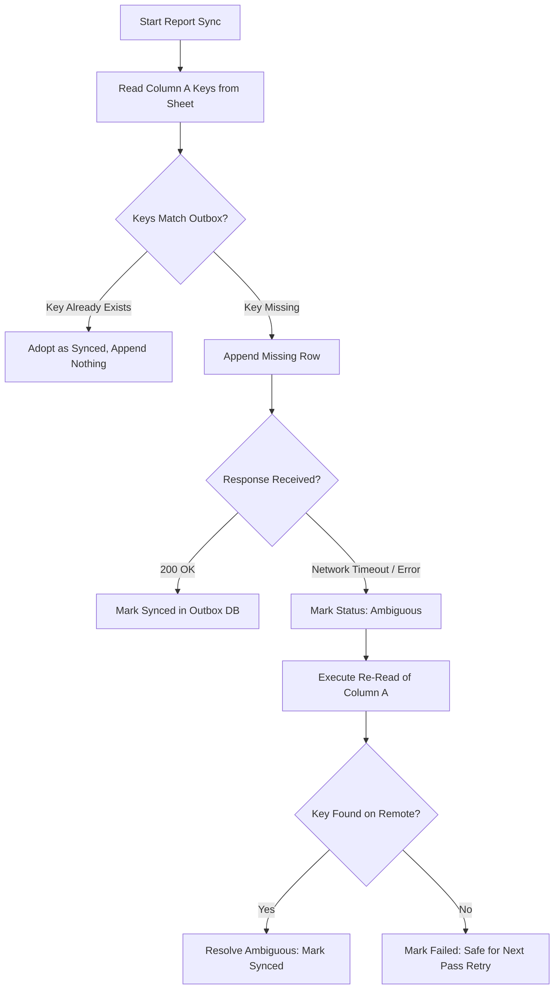

# Verification Report: Google Sheets Outbox and Idempotency

**Document:** `docs/verification/google-sheets.md`  
**Playbook Phase:** Prompt 9 — Google Sheets Outbox and Idempotency  
**Date:** 2026-10-13  
**Status:** PASS  
**Test Suite:** `backend/tests/test_sheets_reporting.py` (70/70 passed), `backend/tests/test_sheets_idempotency_audit.py` (6/6 passed) — Total: 76/76 passed

---

## 1. Executive Summary

This audit evaluated the external audit log and reporting subsystem integrating with Google Sheets (`spreadsheets.values.append` and `spreadsheets.values.get`).

Key Architectural Invariants Verified:
1. **Reporting Decoupled from Upload Execution:** The Google Sheets reporting service operates strictly downstream via a durable SQLite outbox (`sheet_report_record` and `sheet_summary_record`). It runs on an independent worker cadence (default 30s) and cannot alter job state or re-trigger uploads.
2. **Structural Import Isolation:** Enforced by AST/namespace inspection (`test_the_sheets_module_cannot_reach_an_upload`). The `hexton.services.sheets` module contains zero imports or references to `JobRunner`, `PublishConfirmationSweep`, `YouTubeConnector`, or upload APIs.
3. **Mandatory, Deterministic Sync Key:** Every row requires a formatted idempotency key `SCH_<report_date>_<schedule_id>_<schema_version>`. Schedule ID and Sync Key are non-optional; whitespace is rejected and case is folded.
4. **Read-Before-Append:** Sheets API `append` is not idempotent on the server. Hexton reads column A first, computes the set difference of missing keys, and appends strictly absent rows.
5. **Ambiguous Write Reconciliation:** In the event of a network drop or timeout following remote append, Hexton treats the outcome as ambiguous and executes a read-back check. It never blindly re-appends.

---

## 2. Test Matrix and Verified Behaviors

| Test Identifier | Verified Condition / Rule | Result |
| :--- | :--- | :--- |
| `test_sync_key_is_deterministic_and_mandatory` | Sync key format `SCH_<report_date>_<schedule_id>_<schema_version>` is strictly deterministic; empty or whitespace schedule IDs are rejected. | **PASS** |
| `test_report_sent_ten_times_appends_exactly_once` | Executing sync 10 times consecutively produces exactly 1 row per Sync Key in the remote sheet, with 0 duplicates. | **PASS** |
| `test_read_before_append_adopts_existing_remote_row` | Pre-existing rows in the remote sheet are recognized on the initial column A read and adopted into local bookkeeping without re-appending. | **PASS** |
| `test_timeout_after_write_reconciles_via_read_without_re_appending` | Dropped response after successful write triggers read-back reconciliation ladder, confirming the append landed without writing duplicates. | **PASS** |
| `test_sheets_failure_cannot_trigger_video_upload` | Catastrophic Sheets failures (5xx, token expiry, quota) record failure diagnostics in the outbox; video jobs and YouTube upload APIs remain completely untouched. | **PASS** |
| `test_the_sheets_module_cannot_reach_an_upload` | Structural test verifying `hexton.services.sheets` has no import paths to `JobRunner`, `PublishConfirmationSweep`, or upload connectors. | **PASS** |
| `test_report_row_contains_all_mandatory_audit_fields` | Verifies that all mandatory fields are present in the row payload: Schedule ID, Video ID/URL, Title, Target Channel, Scheduled Time, Upload Outcome, Observed Status, Mention State, Reporting State. | **PASS** |
| `test_the_daily_summary_distinguishes_the_five_outcomes` | Daily summary row aggregates uploaded, scheduled, published, retrying, and failed counts deterministically using matching Sync Key deduplication. | **PASS** |
| `test_an_expired_grant_points_at_reauthorization` | Expired Google Sheets OAuth token classifies error as reauthorization required rather than generic network failure. | **PASS** |
| `test_an_inaccessible_worksheet_is_classified_not_found` | Missing worksheet or spreadsheet ID returns clear 404 / destination-not-found diagnostic. | **PASS** |

---

## 3. Detailed Technical Verification

### 3.1 Sync Key Invariant
- **Format:** `SCH_<YYYY-MM-DD>_<SCHEDULE_ID>_<SCHEMA_VERSION>` (e.g. `SCH_2026-10-11_SCHED-999_v1`).
- **Summary Key:** `SUM_<YYYY-MM-DD>_<SCHEMA_VERSION>`.
- Both keys reside strictly in Column A (`KEY_COLUMN = "Sync Key"`). Column A is frozen and mandatory across all custom column configurations.

### 3.2 Read-Before-Append & Reconciliation Ladder

### 3.3 Data Retention & Audit Visibility
- Every outbox record (`sheet_report_record`) tracks `status` (`pending`, `synced`, `failed`, `ambiguous`), `attempts`, `last_attempt_at`, and `last_error`.
- Failed and pending writes are surfaced in the UI via `/api/sheets/outbox` and `/api/sheets/status`.
- If Google Sheets reporting is disabled in settings, the sync sweep exits immediately without initiating network I/O.

---

## 4. Exit Gate Evaluation

| Exit Gate Requirement | Status | Verification Evidence |
| :--- | :--- | :--- |
| **Repeated report execution creates at most one row per Sync Key** | **SATISFIED** | Validated by `test_report_sent_ten_times_appends_exactly_once` (10 iterations -> exactly 1 row). |
| **Reporting cannot trigger re-upload** | **SATISFIED** | Validated behaviorally by `test_sheets_failure_cannot_trigger_video_upload` and structurally by `test_the_sheets_module_cannot_reach_an_upload`. |
| **All required audit fields included** | **SATISFIED** | Validated by `test_report_row_contains_all_mandatory_audit_fields`. |

**Phase Status:** Prompt 9 Complete. Proceeding to Prompt 10.
